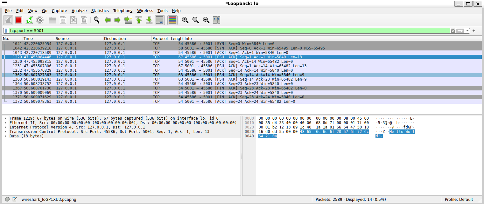
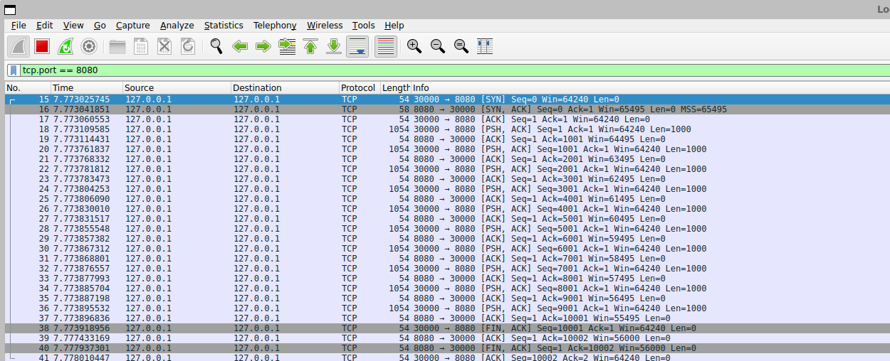

<h1 align="center">Networking Labs</h1>

  <strong>Nine labs that build the internet's protocols by hand: from a web server and a DNS server to TCP connections written byte by byte.</strong> 
  In C, Rust, Java and Python, each one checked against real traffic in Wireshark.

  

  Lab 05 in Wireshark: a complete TCP conversation (open, send <code>Hello World!</code>, reply, close) where every packet was assembled by hand by the lab's client, not by the operating system.

---

## The labs

| Lab | What it builds | In plain words | Language |
| :--- | :--- | :--- | :--- |
| [01](lab01) | **TCP and UDP calculator** | A client sends math expressions to a server over either protocol and gets the answer back, with every message logged. | Rust |
| [02](lab02) | **Web server** | Serves web pages to a browser, handling many visitors at once with a pool of threads. | Java |
| [03](lab03) | **DNS server** | Turns names like `example.com` into addresses: answers from its own records, asks other DNS servers when it doesn't know, and remembers answers for as long as they're valid. | C |
| [04](lab04) | **Time synchronisation (NTP) client** | Asks several public time servers (Google, Apple, Cloudflare, NIST and more) what time it is, measures how long each answer took, and corrects a deliberately wrong clock. | C |
| [05](lab05) | **TCP by hand** | Opens a TCP connection, chats and closes it, building every packet itself through a raw socket (see the capture above). | C |
| [06](lab06) | **Watching ICMP** | Uses `ping`, `traceroute` and wrong addresses to see the network's error messages in Wireshark. (Handout only.) | Wireshark |
| [08](Lab08) | **Link-state routing** | Finds the cheapest path from one router to every other one with Dijkstra's algorithm, printing each step. | Python |
| [09](lab09) | **Speed test by hand** | Measures latency and upload speed over a TCP connection it builds itself, then confirms every byte arrived. | Rust |
| [10](lab10) | **Wi-Fi security exercise** | Recovers the key of an old-style (WEP) Wi-Fi network set up for the class, showing why WEP is broken. | Bash, C |

> ⚠️ **Lab 10 is for authorized use only:** on your own equipment while practising, and on the class network during the official evaluation window. Attacking networks you don't own is illegal.

---

## Highlights

- **No shortcuts on the hard parts.** Labs 05 and 09 skip the operating system's TCP entirely and write each header themselves: ports, sequence numbers, flags and checksums.
- **Real protocols, read from the specs.** The DNS server and NTP client follow the official standards (RFC 1035 and RFC 5905), down to the exact byte layout.
- **Verified on the wire.** Captures in Wireshark confirm that what the code sends is what the protocol expects.

  

Lab 09 in Wireshark: ten 1,000-byte blocks sent one at a time, each acknowledged, then a clean close.

---

## Running the labs

Each lab folder has its own README with build and run steps (some in Spanish). What you need:

| Labs | Tools |
| :--- | :--- |
| 01, 09 | Rust 1.88 or newer |
| 02 (and lab 05's test server) | Java JDK 21 or newer |
| 03, 04, 05 | Linux, `gcc`, `make` (lab 03 also runs on a BeagleBone Black) |
| 08 | Python 3 |
| 05, 09, 10 | `sudo`, since raw sockets and Wi-Fi monitor mode need root |
| 06, 05, 09 | Wireshark |
| 09 | Perl with `Net::Ping`, and `iptables` |
| 10 | The `aircrack-ng` suite, a Wi-Fi adapter with monitor mode, and PlatformIO/ESP-IDF for its ESP32-C3 firmware |

---

## Credits

Made by [@GabGP](https://github.com/GabGP), with [@guillermo-martinez42](https://github.com/guillermo-martinez42), for Computer Science VIII (networking).
